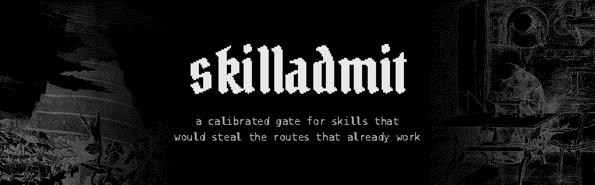
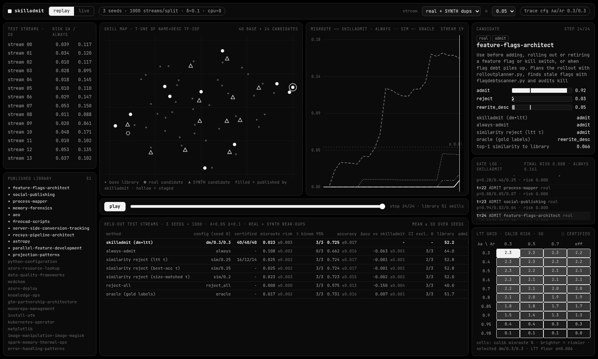
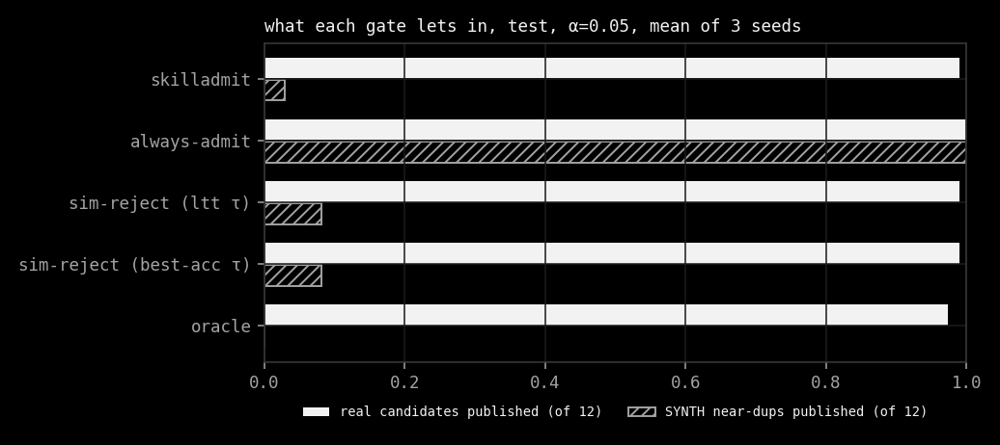
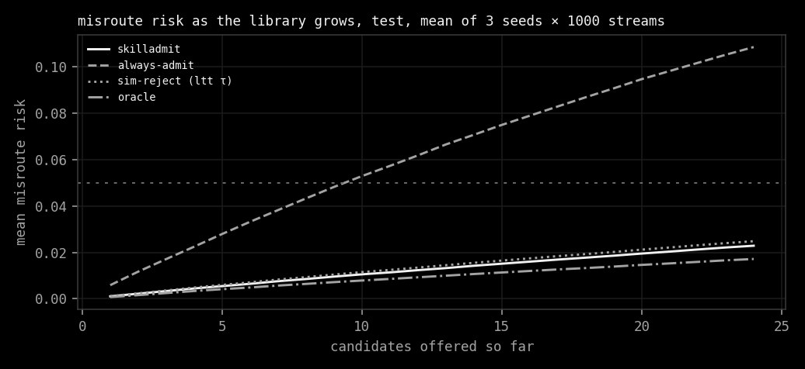
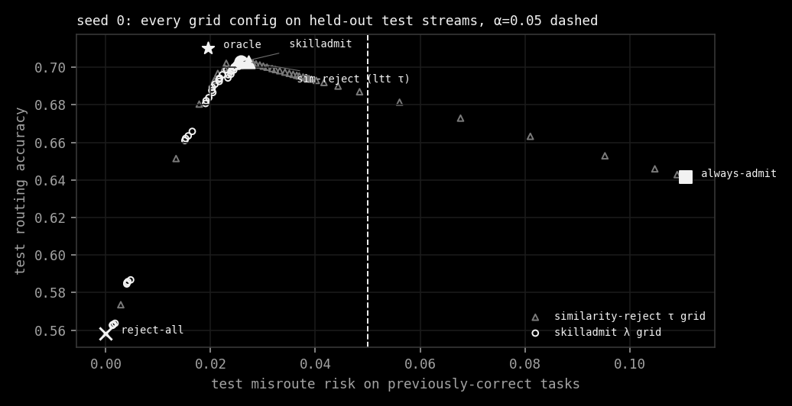
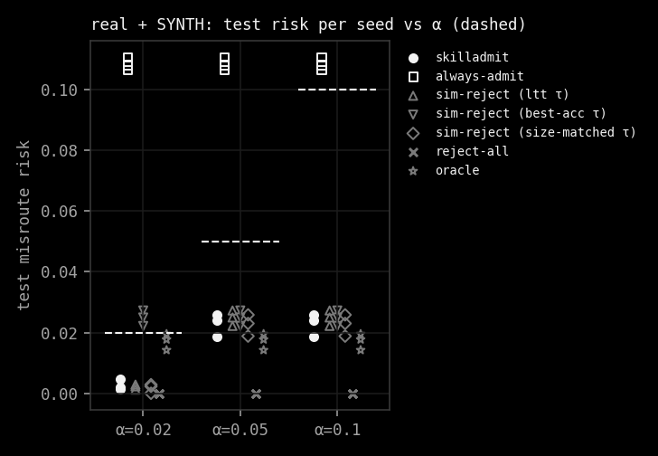
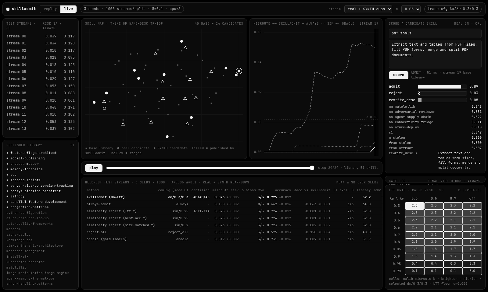
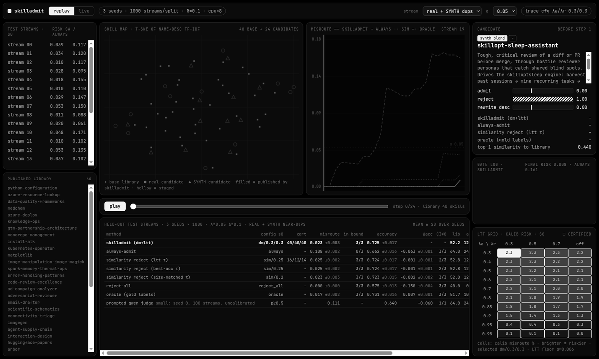

skilladmit is a calibrated admission gate for agent skill libraries. Before a new skill is published, a small typed
decision model picks one of `admit`, `reject` or `rewrite_desc`, and Learn-then-Test picks its thresholds so the
fraction of previously-correct routing tasks the library starts to misroute stays at most α with probability 1 − δ.
The live router (name + description retrieval) is never touched. Only what enters the library changes.

#ai-frontier-research #agent-skills #decision-models #learn-then-test #tool-calling #policy-gates #cpu-inference #lifelong-learning




## The Problem

Skill routers usually pick a skill from its name and description. When a new skill arrives that sounds like an old
one, the router can start sending the old skill's tasks to the newcomer. Nothing about the old skill or the router
changed, and the tasks still break. Skill++ calls this routing interference.

skilladmit watches the door instead of the router. Each candidate is scored against the current library and a fixed
set of probe tasks before it goes live. Rejected skills stay staged. `rewrite_desc` proposes a narrower description
(the candidate's words minus the ones it shares with its nearest neighbour) and the gate retests it.



## The Data

There is no invented data. The pool is 338 real skills from eight pinned public repositories (openai, huggingface,
K-Dense-AI, obra/superpowers, wshobson/agents, alirezarezvani, github/awesome-copilot, microsoft), MIT or Apache-2.0
only. anthropics/skills was read too but none of its open-licensed skills had enough "When to use" bullets to keep. The router sees the frontmatter `name` and `description`, nothing else.

The 2,102 routing tasks are the authors' own "When to use" bullets from each `SKILL.md` body, labelled with the skill
they came from. That is a derived label, not a human annotation, and [docs/DATA.md](docs/DATA.md) says so at length.
Controlled near-duplicates are built from real skills by string edits, are named `SYNTH`, carry `synth=True`, and own
no tasks.

## The Method

Each stream starts from 40 published skills and offers 24 candidates one at a time: 12 real unseen skills and 12
SYNTH near-duplicates (6 renamed copies with 20% of words dropped, 6 blends that graft a library skill's first sentence onto another skill). The decision model
is a multinomial logistic regression over 15 interference features (similarity to the library, how many probe tasks
the candidate would capture, whether a rewrite helps). It is trained on oracle labels from training streams, then
frozen.

Learn-then-Test runs over 40 (λ_admit, λ_rewrite) pairs and 39 similarity thresholds τ with Hoeffding-Bentkus
p-values, Bonferroni across the grid, δ = 0.1, on 1,000 calibration streams. Skill pools are disjoint between train,
calibration and test, so every test candidate and every test library skill is unseen.



## The Results

Three seeds, 1,000 held-out test streams each, CPU only, 31.5 minutes wall on 8 vCPU. At α = 0.05:

| method | misroute risk | accuracy | library | SYNTH published |
|---|---|---|---|---|
| skilladmit | 0.023 ± 0.003 | 0.725 ± 0.017 | 52.2 | 0.35 / 12 |
| always-admit | 0.108 ± 0.002 | 0.662 ± 0.016 | 64.0 | 12 / 12 |
| similarity reject (LTT τ) | 0.025 ± 0.002 | 0.724 ± 0.017 | 52.8 | 0.97 / 12 |
| similarity reject (size-matched τ) | 0.023 ± 0.003 | 0.723 ± 0.015 | 52.0 | 0.41 / 12 |
| oracle (gold labels) | 0.017 ± 0.002 | 0.731 ± 0.016 | 51.7 | 0 / 12 |

The bound holds: test risk sits under α on every seed at α = 0.02, 0.05 and 0.1, and always-admit breaks it at all
three. skilladmit beats always-admit by about 6 accuracy points. It does **not** beat a similarity threshold tuned
on the same calibration split: the gap is −0.07 to +0.35 points against the brief's +3. The hypothesis fails on that
criterion. On this data, "is it too close to something already here" is almost all the signal there is.



| | |
|---|---|
|  |  |

The full tables (every α, every seed, bootstrap CIs, the real-only stream and the small judge arm) are in
[results/summary.md](results/summary.md). The write-up, related work and the failure analysis are in
[docs/REPORT.md](docs/REPORT.md).

## The Screen

`make app` serves a local dashboard of the committed results on `127.0.0.1:8766`. Replay walks a real held-out
stream one candidate at a time: the skill map, the misroute curve of each gate, the typed probabilities and the LTT
grid. Live lets you paste a name and description and scores it with the frozen seed-0 model against a real test
library. It does not publish anything.



## Install

```sh
git clone https://github.com/Sebastianrodaaa/skilladmit
cd skilladmit
pip install numpy scipy scikit-learn pyyaml matplotlib
python3 test_skilladmit.py   # checks against the committed pool and results
make app                     # dashboard on http://127.0.0.1:8766
make data run run_real       # rebuild from the pinned repos (~1 GB clones), ~1 h on 8 vCPU
```

`make data` clones the source repositories into `data/src/` (git-ignored). Results go to `results/`. The optional
judge arm (`make judge`) also needs `torch` and `transformers` and downloads Qwen2.5-0.5B-Instruct (~1 GB) into the
Hugging Face cache. Delete `data/src/` and that cache to undo.

## The Name

Admit as in a door with someone standing at it. The library is a room where everyone already knows their job, and
the new arrival has to show it will not take anyone else's.

## Inspirations

Skill++ for the failure mode, Learn-then-Test for the guarantee, Decision Models as Policy Gates and Prism for the
typed gate, and our own prefixgate for the scaffolding. The full list is in [INSPIRATIONS.md](INSPIRATIONS.md).

## License

MIT. The skill metadata, the model and the banner art have their own terms, listed in [NOTICE.md](NOTICE.md).
