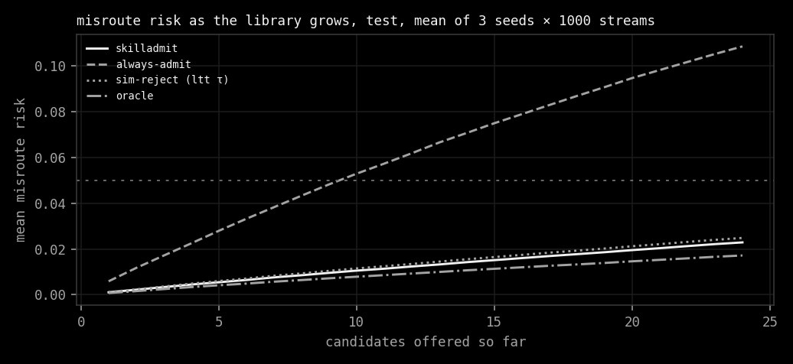
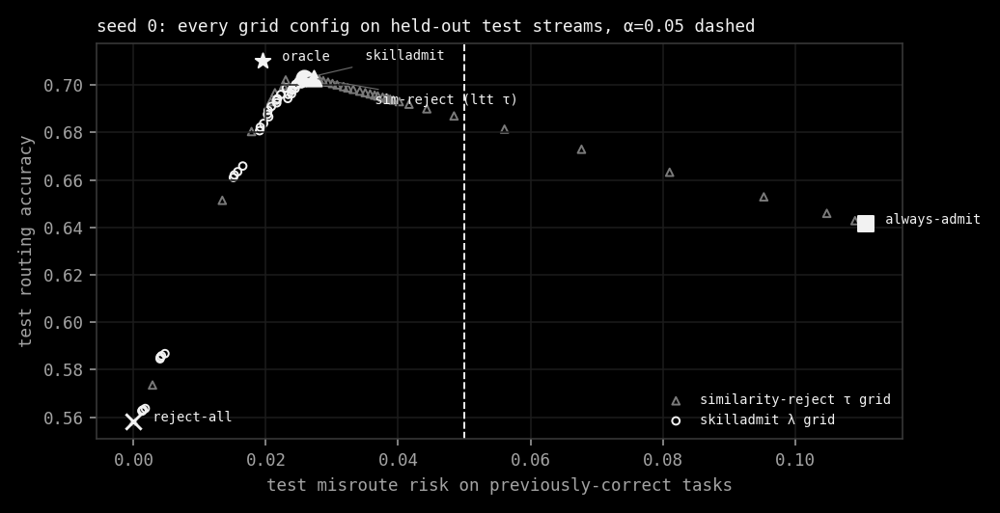
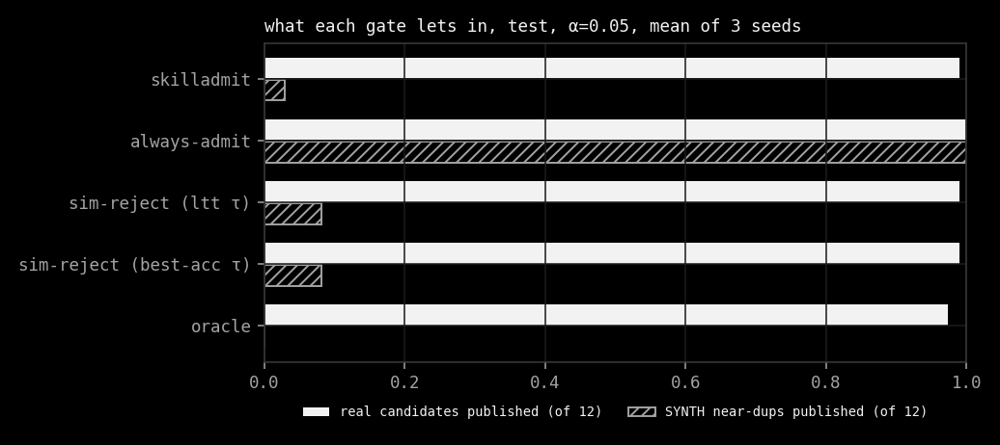
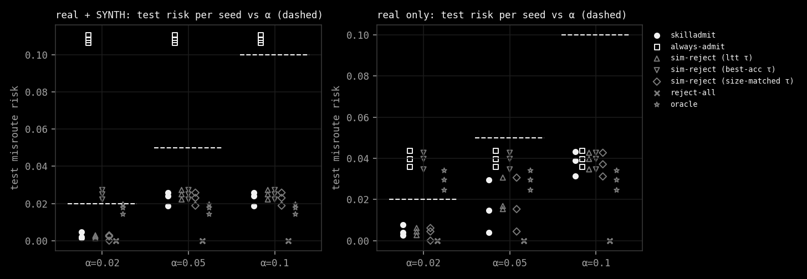

# skilladmit: a Learn-then-Test admission gate for growing skill libraries

Every number below comes from `results/*.json` and is reproduced by the commands in the last section. All runs are
CPU-only (8 vCPU, no GPU, no paid API). Nothing here was run and then left out.

## 1. Question

Skill++ (arXiv:2611.00544) shows that under name+description routing, adding a new skill that sounds like an old
one can steal the old skill's tasks, even though the old skill and the router did not change. Can a small typed
decision model, calibrated with Learn-then-Test, decide which candidates to let into the library so that

> the fraction of previously-correct routing tasks that the library starts to misroute stays at most α with
> probability at least 1 − δ,

while the router itself stays fixed, and while doing better than the obvious baselines?

### Pre-registered hypothesis (from the brief)

On a held-out lifelong skill stream:

1. skilladmit keeps post-admission misroute rate inside the LTT α bound (empirical rate inside the binomial 95%
   interval of α);
2. at matched final library size, end-of-stream routing accuracy is at least **5 points** above always-admit and at
   least **3 points** above a description-similarity reject baseline whose τ is tuned on the same calibration split.

It fails if either bound is violated, if the CI on the gap vs the better baseline includes 0, or if always-admit
already stays under α.

## 2. Data

Details and caveats are in [DATA.md](DATA.md). In short:

- **Skills.** 338 real skills from 8 pinned public repositories (MIT or Apache-2.0 only; anthropics/skills was
  read but contributed none, see NOTICE.md). The router sees the frontmatter `name: description`.
- **Tasks.** 2,102 routing tasks, the "When to use" / "Use cases" / trigger bullets that the skill authors wrote in
  each `SKILL.md` body, labelled with the skill they came from (median 6 per skill, median 7 words). Duplicate
  bullets and bullets that appear under two skills are dropped. **These labels are derived from source provenance,
  not from human annotation of intent.** Two skills can legitimately serve one bullet, and that is counted as a
  misroute.
- **Probe / evaluation split.** Even-indexed bullets of each skill are probe tasks the gate may look at; odd-indexed
  bullets are evaluation tasks it never sees. All risks and accuracies below are on evaluation tasks.
- **SYNTH candidates.** Controlled near-duplicates, built by string edits from real skills, named with a `SYNTH`
  suffix and flagged `synth=True`: a *copy* of a library skill (renamed, 20% of description words dropped at random) and a *blend* (the
  first sentence of a library skill's description grafted onto the renamed name and remaining sentences of an
  unused pool skill). They own no
  tasks. They model the copy-paste fork, which is exactly the Skill++ failure mode.
- **Pools.** Per seed the 338 skills are split into four disjoint pools: train (112), calibration (112), test (114)
  and test-IID (112, a second test pool from the same split). No test skill is seen in training or calibration,
  either as a library member or as a candidate.

## 3. Method

**Router (unchanged in every arm).** TF-IDF (word 1–2 grams, sublinear tf, English stop words) fit once on the
train pool's `name: description` text, cosine similarity, top-1. Admitting a skill adds one row to the index; the
vectorizer and every existing row stay as they were (`test_gate_never_changes_the_router`).

**Stream.** Each episode draws 40 base skills and 24 candidates from one pool: 12 real unseen skills, 6 SYNTH
copies and 6 SYNTH blends of base skills, shuffled. Candidates arrive one at a time.

**Risk.** A task is *previously correct* if it was routed to its own skill at the moment that skill entered the
library (base skills at step 0). The episode's misroute risk is the fraction of previously-correct evaluation tasks
that are routed elsewhere at the end of the stream. Accuracy is top-1 accuracy over all evaluation tasks of skills
that exist in the stream, so rejecting a real skill costs its tasks.

**Decision model.** For each candidate the gate computes 15 features against the current library and the probe
tasks: top-1/top-2/top-3 similarity to the library, name overlap, how many and what fraction of currently-correct
probe tasks the candidate would capture, the same for its rewritten description, and description length. A
multinomial logistic regression maps them to a simplex over **A = (admit, reject, rewrite_desc)**. It is trained on
oracle labels from 400 training streams per seed (9,600 decisions; label counts about 4.2k admit, 5.0k reject,
0.35–0.54k rewrite), where the label is the option with the largest (own tasks won − library tasks misrouted), ties
to reject. Training accuracy is 0.93–0.94. Then it is frozen.

**rewrite_desc.** A deterministic stand-in for an author edit: drop description words shared with the nearest
library skill. If fewer than 4 content words would remain the option is unavailable.

**Gate.** Configuration λ = (λ_admit, λ_rewrite): admit if p(admit) ≥ λ_admit; else publish the rewrite if
p(rewrite_desc) ≥ λ_rewrite; else reject (the skill stays staged). λ_admit ∈ {0.3 … 0.98} (10 values), λ_rewrite ∈
{0.3, 0.5, 0.7, off}: 40 configurations.

**Learn-then-Test.** For each configuration, the mean episode risk on 1,000 calibration streams gives a
Hoeffding-Bentkus p-value for H₀: risk > α. Bonferroni over the whole grid at δ = 0.1. Among certified
configurations, pick the one with the highest calibration accuracy. If none is certified, the gate rejects
everything. With 1,000 streams and this grid the smallest certifiable α is about 0.006 (`ltt_floor_alpha`).

**Arms.**

| arm | what it does |
|---|---|
| skilladmit | DM + LTT as above |
| always-admit | publishes every candidate |
| similarity reject (LTT τ) | reject if max cosine to the library > τ; τ ∈ {0, 0.025, …, 0.95} certified with the same LTT procedure |
| similarity reject (best-acc τ) | the τ with the best calibration accuracy, ignoring risk |
| similarity reject (size-matched τ) | the τ whose calibration library size is closest to skilladmit's; the brief's "matched final library size" comparison |
| reject-all | publishes nothing |
| oracle | the gold-label net-benefit decision; an upper reference, not a method |
| prompted judge | Qwen2.5-0.5B-Instruct on CPU, p(admit) vs p(reject) from next-token logits given the 5 nearest library skills, admit if ≥ 0.5; small-scale and uncalibrated |

Prism (the open decision model that inspired the typed gate) needs roughly 106 GB of weights and a large GPU, so it
was not run.

**Statistics.** Three seeds (0, 1, 2), each with its own pool split, training, calibration and 1,000 test streams.
The bound check is the pooled test risk against the upper 97.5% binomial quantile of α at the pooled number of
previously-correct tasks. Accuracy gaps are paired bootstrap 95% CIs over test streams (2,000 resamples), per seed.

## 4. Results

### 4.1 Real + SYNTH stream (3 seeds × 1,000 test streams)

Mean ± sd over seeds, test pool.

| α | method | config (seed 0) | misroute risk | inside bound | accuracy | library | SYNTH published / 12 | real staged / 12 |
|---|---|---|---|---|---|---|---|---|
| 0.02 | skilladmit | dm/0.95/0.3 | 0.0027 ± 0.0015 | 3/3 | 0.594 ± 0.009 | 41.4 | 0.01 | 10.60 |
| 0.02 | similarity (LTT τ) | sim/0.025 | 0.0021 ± 0.0007 | 3/3 | 0.594 ± 0.017 | 41.4 | 0.00 | 10.61 |
| 0.05 | skilladmit | dm/0.3/0.3 | 0.0229 ± 0.0030 | 3/3 | 0.725 ± 0.017 | 52.2 | 0.35 | 0.13 |
| 0.05 | always-admit | always | 0.1085 ± 0.0017 | 0/3 | 0.662 ± 0.016 | 64.0 | 12.00 | 0.00 |
| 0.05 | similarity (LTT τ) | sim/0.25 | 0.0248 ± 0.0021 | 3/3 | 0.724 ± 0.017 | 52.8 | 0.97 | 0.13 |
| 0.05 | similarity (size-matched τ) | sim/0.2 | 0.0226 ± 0.0029 | 3/3 | 0.723 ± 0.015 | 52.0 | 0.41 | 0.41 |
| 0.05 | reject-all | reject_all | 0 | 3/3 | 0.575 ± 0.013 | 40.0 | 0 | 12 |
| 0.05 | oracle | oracle | 0.0172 ± 0.0022 | 3/3 | 0.731 ± 0.016 | 51.7 | 0 | 0.32 |

At α = 0.1 every arm selects the same configuration as at α = 0.05. Full per-seed rows, with every α and CI, are
in [results/summary.md](../results/summary.md).

Accuracy gap, skilladmit − method, α = 0.05, paired bootstrap 95% CI per seed (points):

| vs | seed 0 | seed 1 | seed 2 |
|---|---|---|---|
| always-admit | +6.11 [+5.98, +6.23] | +6.28 [+6.15, +6.41] | +6.39 [+6.27, +6.51] |
| similarity (LTT τ) | −0.01 [−0.05, +0.02] | +0.13 [+0.08, +0.18] | +0.05 [+0.03, +0.07] |
| similarity (size-matched τ) | −0.07 [−0.11, −0.04] | +0.35 [+0.28, +0.41] | +0.32 [+0.27, +0.37] |

LTT certified 40/40 DM configurations at α = 0.05 and 0.1 and 8/40 at α = 0.02 on every seed. For the similarity
arm it certified 12–16 of 39 thresholds at α = 0.05 and 2 at α = 0.02. The test-IID pool agrees with the test pool
to within 0.002 risk (skilladmit at α = 0.05: 0.0247 on test-IID, 0.0229 on test).







### 4.2 Real candidates only (3 seeds × 1,000 test streams)

Same pools, router, training and grid, but each stream offers 24 real unseen skills and no SYNTH candidates. This
is the check that the result is not an artefact of the string-edit duplicates.

| α | method | config (seed 0) | misroute risk | inside bound | accuracy | library | real staged / 24 |
|---|---|---|---|---|---|---|---|
| 0.02 | skilladmit | dm/0.95/0.7 | 0.0048 ± 0.0021 | 3/3 | 0.497 ± 0.006 | 42.6 | 21.39 |
| 0.02 | always-admit | always | 0.0397 ± 0.0032 | 0/3 | 0.709 ± 0.018 | 64.0 | 0 |
| 0.02 | similarity (LTT τ) | sim/0.025 | 0.0044 ± 0.0014 | 3/3 | 0.497 ± 0.016 | 42.8 | 21.24 |
| 0.05 | skilladmit | dm/0.9/0.3 | 0.0161 ± 0.0104 | 3/3 | 0.577 ± 0.052 | 50.4 | 13.56 |
| 0.05 | always-admit | always | 0.0397 ± 0.0032 | 3/3 | 0.709 ± 0.018 | 64.0 | 0 |
| 0.05 | similarity (LTT τ) | sim/0.075 | 0.0209 ± 0.0069 | 3/3 | 0.622 ± 0.017 | 54.8 | 9.20 |
| 0.05 | similarity (size-matched τ) | sim/0.075 | 0.0168 ± 0.0107 | 3/3 | 0.588 ± 0.052 | 51.6 | 12.41 |
| 0.05 | oracle | oracle | 0.0294 ± 0.0039 | 3/3 | 0.717 ± 0.017 | 63.3 | 0.74 |
| 0.1 | skilladmit | dm/0.3/0.3 | 0.0378 ± 0.0049 | 3/3 | 0.708 ± 0.018 | 63.7 | 0.29 |
| 0.1 | always-admit | always | 0.0397 ± 0.0032 | 3/3 | 0.709 ± 0.018 | 64.0 | 0 |
| 0.1 | similarity (LTT τ) | sim/0.25 | 0.0390 ± 0.0033 | 3/3 | 0.708 ± 0.017 | 63.7 | 0.31 |

This is a clean negative. With only real candidates, always-admit's risk (0.036–0.044 per seed) is already under
α = 0.05 and 0.1, which is one of the brief's failure conditions. The gate still holds its bound, but at α = 0.05 it
pays for it: LTT cannot certify the permissive configurations, so skilladmit stages 13.6 of 24 real skills and loses
6.4, 10.9 and 22.4 points of accuracy to always-admit on the three seeds. The similarity arm has the same problem
(it loses less on two seeds, more on none). At α = 0.1 every gate converges on "admit almost everything" and they
tie within 0.7 points.

The cause is the finite-sample price of the guarantee, not the model. A Hoeffding-Bentkus test with 1,000
calibration streams and a Bonferroni split over 40 configurations needs a calibration risk of about 0.03 to certify
α = 0.05 (p = 0.0035 at 0.030, 0.039 at 0.035, against a threshold of 0.0025). The permissive configurations sit at
0.039–0.047, so they are refused even though their true risk is under α. Fixed-sequence testing (ordering the grid
from strict to permissive) or more calibration streams would shrink that gap; neither was pre-registered, so neither
is reported as the result.




### 4.3 Prompted judge (small-scale: seed 0, 100 real + SYNTH test streams, uncalibrated)

Qwen2.5-0.5B-Instruct (pinned revision `7ae5576`, fp32, CPU) sees the candidate and its 5 nearest library skills and
answers admit or reject. p(admit) comes from the next-token logits of the two words, and the arm admits when
p(admit) ≥ 0.5. It is not calibrated and not risk-controlled, and it ran on 100 streams instead of 1,000 because
2,397 distinct prompts took 89 minutes. All five arms below use the same 100 streams.

| method | misroute risk | accuracy | library | admitted / 24 |
|---|---|---|---|---|
| prompted judge | 0.1115 | 0.6400 | 63.98 | 23.98 |
| always-admit | 0.1115 | 0.6402 | 64.00 | 24.00 |
| skilladmit (α = 0.05) | 0.0276 | 0.7000 | 52.34 | 12.16 |
| similarity (LTT τ) | 0.0294 | 0.7003 | 53.03 | 13.03 |
| oracle | 0.0207 | 0.7075 | 51.78 | 10.49 |

The judge is degenerate. It said admit to 2,398 of the 2,400 candidates, including all 12 SYNTH forks per stream, so
it is always-admit with an 89-minute overhead. Skilladmit is 6.0 points more accurate than the judge (paired
bootstrap 95% CI [5.6, 6.4]). A 0.5B model asked "does this overlap?" does not see near-duplicates that a TF-IDF
cosine catches. Larger judges (Prism, the brief's suggested DM) do not fit on CPU and were not run.


### 4.4 Wall-clock

All on one 8-vCPU box, no GPU, `multiprocessing` over streams.

| run | wall | note |
|---|---|---|
| real + SYNTH, 3 seeds × (400 train + 3 × 1,000 eval streams) | 31 min 27 s | 588–666 s per seed |
| real only, 3 seeds, same sizes | 65 min 7 s | 1,193–1,383 s per seed; shared the CPU with the judge run |
| judge arm, seed 0, 100 streams | 89 min 4 s (2,397 prompts) | Qwen2.5-0.5B fp32 on CPU, shared the CPU with the real-only run |
| one gate decision (DM features + scoring) | ~50–70 ms | dashboard live mode, 40-skill library |
| DM training per seed | 2–4 s | 9,600 rows |


## 5. Verdict

| criterion | result |
|---|---|
| (1) risk inside the α bound | **holds**: 9/9 seed × α cells for skilladmit on each stream (18/18) |
| always-admit not already under α | **holds on real + SYNTH** (risk 0.108, over every α tested); **fails on real only** (risk 0.040, under α = 0.05 and 0.1) |
| (2a) ≥ 5 points above always-admit | **holds on real + SYNTH** (+6.1 to +6.4, CIs exclude 0); **fails on real only** (−6.4 to −22.4 at α = 0.05, −0.1 to −0.2 at α = 0.1). always-admit cannot be size-matched, it always ends at 64 skills |
| (2b) ≥ 3 points above similarity reject | **fails**: real + SYNTH −0.07 to +0.35 points vs the size-matched τ, −0.01 to +0.13 vs the LTT τ; real only −11.5 to +0.2 |
| CI on gap vs the better baseline excludes 0 | **fails**: seed 0 vs the LTT τ includes 0; vs the size-matched τ, seed 0 is significantly negative |

**The hypothesis fails**, on both streams. On real + SYNTH the risk guarantee is real and holds out of sample, and gating clearly beats admitting
everything. But the typed model does not earn its keep over a single calibrated similarity threshold. The oracle,
which knows the gold labels, is only 0.6–0.7 points above skilladmit, so the ceiling for *any* gate on this data is
far below the 3-point target. Most of the decision is already carried by "how close is this to something already
here".

What the DM does differently is which skills it refuses. At matched size it publishes fewer SYNTH duplicates (0.35
vs 0.41 per stream) and stages fewer real skills (0.13 vs 0.41), and its rewrite path publishes about 0.26
narrowed descriptions per stream. These are small effects on accuracy.

On the real-only stream the gate is not needed at α ≥ 0.05, because admitting everything is already safe, and at
α = 0.05 the LTT certificate makes it refuse useful skills (section 4.2).

## 6. Why it failed, and what would change it

- **The task set is easy to protect.** With TF-IDF over names and descriptions, near-duplicates that steal routes
  are also lexically close. Similarity is then a near-sufficient statistic. A semantic router (dense embeddings or
  an LLM router) would let paraphrased duplicates through a lexical threshold; that is where a probe-based gate
  should win, and it is not tested here.
- **The oracle ceiling is low.** Most real candidates help and most SYNTH candidates hurt, so both gates already
  make the obvious calls. Harder streams (more real overlap, fewer clean forks) would separate them more.
- **Derived labels are noisy.** A bullet that two skills could serve counts as a misroute if it moves. That inflates
  measured risk for every gate equally but caps achievable accuracy.
- **The rewrite operator is a stand-in.** Dropping shared words is not an author's edit. A real rewrite loop (LLM or
  human) is exactly where `rewrite_desc` could add value and it was not available on CPU within budget.

## 7. Related work

- **Skill++** (arXiv:2611.00544) diagnoses routing interference and proposes routing-aware skill refinement. It does
  not gate admission with a calibrated decision model.
- **Learn then Test** (Angelopoulos et al., arXiv:2110.01052) gives the distribution-free risk control used here.
- **Decision Models as Policy Gates** (arXiv:2611.02155) and **sarvamai/prism** gate tool calls with typed decision
  models over a fixed option set. skilladmit applies the same shape to library growth.
- **TalentRL** (arXiv:2610.41143), **Structure-Aware Skill Retrieval** (arXiv:2610.41909), **SEEK**
  (arXiv:2609.29803) and **Skill-RAG** (arXiv:2604.15771) learn which skill to pick for a task. skilladmit leaves the
  picker alone and controls which skills exist.
- **prefixgate** (Sebastianrodaaa/prefixgate) is the earlier streaming LTT gate on tool-call prefixes that this
  repo's LTT and dashboard code come from.

## 8. Limitations

- One router family (TF-IDF cosine, top-1). The guarantee is with respect to this router; a different router needs
  recalibration.
- Labels are derived from authorship, not annotated intent.
- Half of the candidates are SYNTH string edits. The real-only stream (4.2) is the check that the result does not
  depend on them.
- The guarantee is marginal over streams drawn like the calibration streams (exchangeability). A library that drifts
  in topic over time is not covered.
- 338 skills, 2,102 tasks: small. The prompted judge is small-scale (one seed, 100 streams) and uncalibrated.

## 9. Reproduce

```sh
pip install numpy scipy scikit-learn pyyaml matplotlib
make data       # clone pinned repos, build data/skills.jsonl.gz
make run        # 3 seeds × 1000 streams, real + SYNTH  -> results/metrics.json
make run_real   # 3 seeds × 1000 streams, real only     -> results/metrics_real_only.json
make judge      # optional, needs torch + transformers  -> results/judge.json
make plots      # docs/screenshots/*.png, results/summary.md
python3 test_skilladmit.py
```
